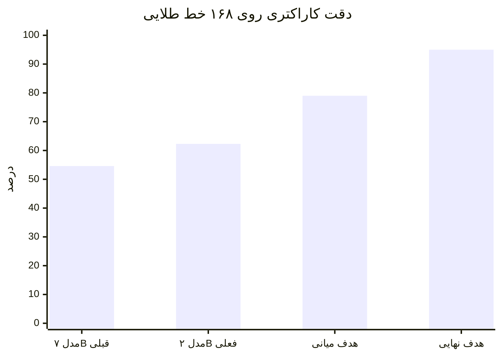
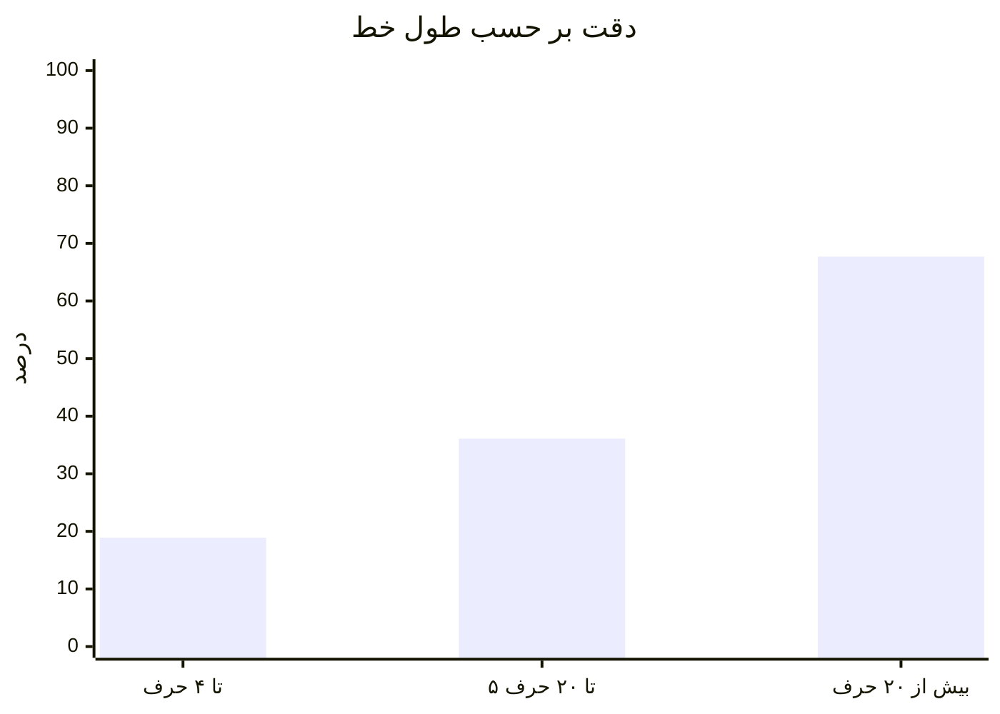
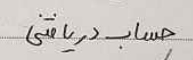
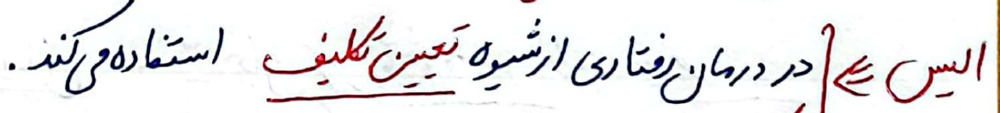
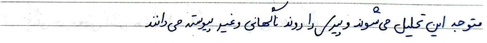
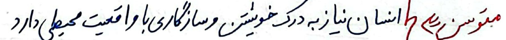
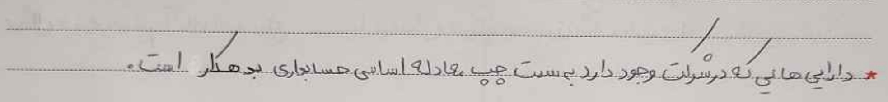
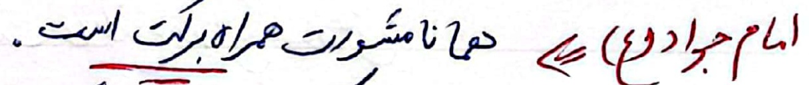
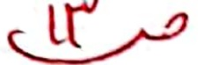
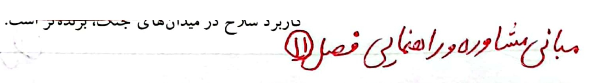

# گزارش مختصر آزمایش OCR دست‌نویس فارسی

**تاریخ:** ۲۰۲۶-۰۹-۱۹  
**معیار:** CER روی مجموعهٔ طلایی دستی (۱۶۸ خط دارای متن)

---

## نتیجه

بهترین مدل محلی (`Qwen3-VL-2B` مخصوص تک‌خط فارسی) روی خطوط رونویسی‌شدهٔ انسان به

**دقت کاراکتری ۶۲٫۳٪ (CER = ۰٫۳۷۷)**

رسید. مدل قبلی محلی ۷ میلیارد پارامتری ۵۴٫۶٪ بود.

```
CER = (جایگزینی + حذف + درج) / طول متن طلایی
دقت کاراکتری = ۱ − CER
```

| مدل | CER | دقت | WER |
|------|-----|------|------|
| **Qwen3-VL-2B Persian line-OCR** | **۰٫۳۷۷** | **۶۲٫۳٪** | ۰٫۷۴ |
| Qwen2.5-VL-7B محلی | ۰٫۴۵۴ | ۵۴٫۶٪ | ۰٫۷۷ |
| تشخیص خط Surya (بدون مدل vison خطی) | — | برای دست‌نویس قابل استفاده نبود | — |



---

## داده و روش آزمایش

1. صفحات اسکن‌شده به **خطوط** بریده شدند (Surya + فیلتر هندسی): **۲۲٬۲۵۰** کراپ از ۹۴۵ صفحه.
2. تقسیم train/val/test **در سطح سند** است؛ نشتی سند/صفحه/کراپ بین splitها **صفر** است.
3. مجموعهٔ طلایی: **۲۴۰** خط از split تست، رونویسی دستی. ۱۶۸ خط متن دارند؛ ۷۲ خط ناخوانا از نمره حذف شدند.
4. هر مدل همان کراپ را جداگانه خواند (نه متن کل صفحه). عدد CER توافق با مدل دیگر نیست؛ مقایسه با انسان است.

علت اصلی خطای ۶۲٪: کراپ‌های خیلی کوتاه. روی خطوط بلند دقت حدود **۶۸٪** است.



---

## نمونه‌های آزمایش

همه از مجموعهٔ طلایی‌اند. تصویر همان ورودی مدل است.

### ۱) تطابق کامل — CER = ۰



| | |
|--|--|
| طلایی | حساب دریافتی |
| مدل | حساب دریافتی |

### ۲) خط بلند، خطای جزئی — CER = ۰٫۰۴



| | |
|--|--|
| طلایی | الیس: در درمان رفتاری از شیوه تعیین تکلیف استفاده میکند |
| مدل | الیس در درمان رفتاری از شیوه تعیین تکلیف استفاده میکند. |

تفاوت عمدتاً نقطه‌گذاری است.

### ۳) خط بلند، چند حرف اشتباه — CER = ۰٫۰۹



| | |
|--|--|
| طلایی | متوجه این تحلیل می‌شوند و پیری را روند ناگهانی و غیر پیوسته می‌دانند |
| مدل | متوجه این تکلیل می‌سوند و پیرک را روند نالحاتی و غیر پیوسته می‌دانند |

ساختار جمله درست است؛ چند حرف نزدیک به هم اشتباه شده (`تحلیل→تکلیل`).

### ۴) خط متوسط، قابل خواندن ولی پرخطا — CER = ۰٫۱۶



| | |
|--|--|
| طلایی | متوسن: انسان نیاز به درک خویستن و سازگاری با واقعیت محیطی دارد |
| مدل | متوسنه که انشان نیاز به درک خموشیست و سازگاری با و اقتعیت محیطی دارد |

(برچسب طلایی املای نویسنده را حفظ کرده، نه املای صحیح.)

### ۵) دست‌نویس حسابداری — CER = ۰٫۲۴



| | |
|--|--|
| طلایی | دارایی‌هایی که در شرکت وجود دارد به سمت چپ معادله اساسی حسابداری بدهکار است. |
| مدل | دارنی هانی نه در سریت وجود دارید به سست چپ معا دل۹ اساتی هسادجاری بدهکلر است. |

معنی کلی تا حدی حفظ شده؛ حروف شبیه به هم زیاد جابه‌جا شده‌اند.

### ۶) نقل‌قول کوتاه — CER = ۰٫۱۷



| | |
|--|--|
| طلایی | امام جواد(ع): همانا مشورت همراه برکت است. |
| مدل | امام جباد (ع)» دهانه امشورت همراه برکت است. |

### ۷) کراپ تک‌حرف — CER = ۱٫۰ (شکست کامل)



| | |
|--|--|
| طلایی | ص |
| مدل | میک |

روی کراپ‌های خیلی کوتاه مدل غالباً حدس می‌زند یا کاراکتر اضافه می‌سازد. این دسته دقت کل را پایین می‌کشد.

### ۸) توهم متن اضافه — CER = ۱٫۰



| | |
|--|--|
| طلایی | مبانی مشاوره و راهنمایی: فصل ۱۱ |
| مدل | میانی مشاوره دور اهلنای فصل۱۱ تاربرد سارح در میدانهای جنگ، برده‌تر است. |

بخشی از عنوان درست است؛ ادامه ساختگی است.

---

## جمع‌بندی برای قدم بعد

- پیکرهٔ خطی و مجموعهٔ طلایی آماده است؛ عدد ۶۲٫۳٪ روی hold-out دستی قابل دفاع است.
- روی **خطوط جمله‌دار** مدل نزدیک ۶۸٪ است؛ گلوگاه کراپ‌های کوتاه، فرمول ریاضی، و توهم متن است.
- مسیر پیشنهادی تا ۷۹٪+: فیلتر کراپ‌های خیلی کوتاه + fine-tune روی همین خطوط (جزئیات در `ROADMAP_to_79_percent.md`).
