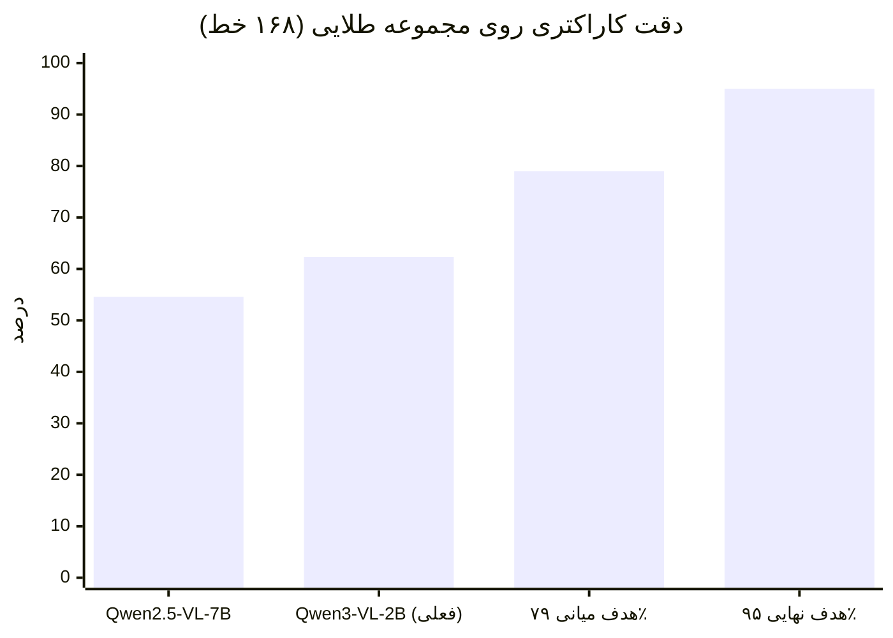
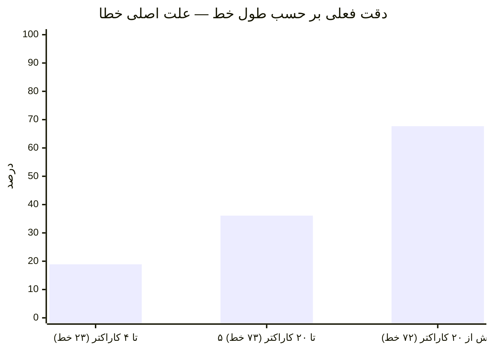
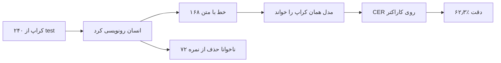
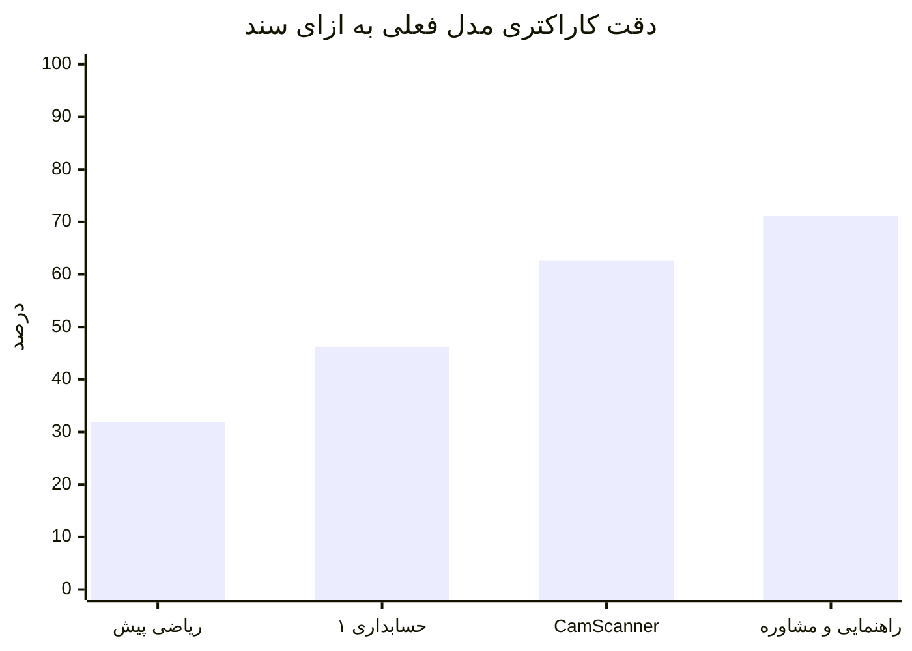

# گزارش ساخت دیتاست و انتخاب موتور برچسب‌زنی

> این فایل برای **ارائه به استاد** نوشته شده. هر عددی که اینجا هست از یک اجرای واقعی
> روی همین مخزن آمده و فایل خروجی‌اش در `dataset/` موجود است. هیچ عددی تخمینی نیست
> مگر جایی که صریح نوشته شده «تخمین».
>
> تاریخ: ۲۰۲۶-۰۹-۱۹

---

## ۱. خلاصهٔ یک‌خطی

پیکرهٔ ۹۴۵ صفحه‌ای به **۲۲٬۲۵۰ کراپ سطح‌خط** تبدیل شد، یک **مجموعهٔ طلایی دستی
۲۴۰ خطی** ساخته شد، و موتورهای OCR محلی روی همان مجموعه سنجیده شدند. بهترین مدل
به **دقت کاراکتری ۶۲٫۳٪ (CER = ۰٫۳۷۷)** رسید.

---

## ۲. دقت الان چقدر است، چرا، و چطور اندازه گرفته شد

**عدد فعلی:** روی ۱۶۸ خطِ دارای متن در `dataset/gold.jsonl`، مدل
`mohajesmaeili/Qwen3-VL-2B-Persian-Arabic-Ocr-v1.0` به **CER = ۰٫۳۷۷** رسید؛
یعنی از هر ۱۰۰ کاراکتر، حدود **۶۲ کاراکتر درست** است.

**چطور اندازه گرفته شد.** مجموعهٔ طلایی را انسان از split تست رونویسی کرد
(۲۴۰ کراپ؛ ۱۶۸ تا متن دارند و ۷۲ تا ناخوانا هستند و در نمره حذف می‌شوند). خروجی
مدل با همان خطوط مقایسه شد. معیار:

```
CER = (جایگزینی + حذف + درج) / تعداد کاراکترهای متن طلایی
دقت کاراکتری = ۱ − CER
```

اسکریپت: `scripts/eval_local_hf_gold.py` · گزارش: `dataset/report_qwen3-vl-2b-persian-arabic-ocr-v1.0.json`

**چرا این عدد است و نه بالاتر.** خطا تقریباً تمام در کراپ‌های کوتاه جمع شده:
روی خطوط بلند (بیش از ۲۰ کاراکتر) دقت **۶۸٪** است؛ روی خطوط تا ۴ کاراکتر فقط
**۱۹٪**. مدل روی تک‌حرف و تک‌رقم غالباً یک جمله می‌سازد و CER آن خط ۱٫۰ می‌شود.
جزوهٔ ریاضی هم سخت‌ترین سند است (دقت حدود ۳۲٪)، چون فرمول و نماد دارد.







| مدل | CER | دقت کاراکتری | WER | زمان هر خط |
|------|-----|------------------|-----|------------|
| **Qwen3-VL-2B Persian line-OCR** | **۰٫۳۷۷** | **۶۲٫۳۰٪** | ۰٫۷۴۲ | ۱٫۴۵ ثانیه |
| Qwen2.5-VL-7B محلی | ۰٫۴۵۴ | ۵۴٫۵۸٪ | ۰٫۷۷۲ | ۳٫۷۴ ثانیه |

بهبود نسبی خطا نسبت به مدل قبلی: **۱۷٪**. مدل برنده کوچک‌تر است (۲ میلیارد در برابر
۷ میلیارد پارامتر) و حدود ۲٫۵ برابر سریع‌تر.

---

## ۳. مسئله‌ای که اول باید حل می‌شد: دیتاست قبلی غلط بود

دیتاست اولیه (`dataset/lines.jsonl`) این‌طور ساخته شده بود:

1. کل صفحه به یک مدل داده می‌شد و متن صفحه برمی‌گشت.
2. Surya جعبه‌های خط را روی همان صفحه پیدا می‌کرد.
3. جعبه‌ها و خطوط متن **با شمارهٔ ترتیب** به هم چسبانده می‌شدند، بعد از بریدن به
   `min(تعداد جعبه، تعداد خط متن)`.

مشکل ساختاری است، نه تنظیماتی: Surya حدود ۳۱ جعبه در هر صفحه پیدا می‌کند ولی مدل
حدود ۱۷ خط متن برمی‌گرداند. نتیجه این شد که از ۱۷٬۱۸۶ ردیف ساخته‌شده، **حدود ۹۶٫۵٪
متنِ خطِ دیگری را حمل می‌کردند**. چنین دیتاستی برای آموزش بی‌فایده است و بدتر از آن،
معیار ارزیابی را هم خراب می‌کند.

**راه‌حل:** هر کراپ **جداگانه** رونویسی شود. یک تصویر ورودی، یک متن خروجی. دیگر
هیچ لیستی وجود ندارد که بد جفت شود. این در `scripts/extract_and_align_lines.py`
پیاده شد.

---

## ۴. ساخت پیکرهٔ سطح‌خط

خروجی: `dataset/lines_v3.jsonl` + پوشهٔ `dataset/lines_v3/`
گزارش: `dataset/geometry_filter_report.json`

| مرحله | عدد |
|-------|-----|
| صفحات اولیه | ۱٬۰۰۸ |
| بعد از حذف تصاویر بایت‌به‌بایت تکراری | **۹۴۵** (۶۳ تکراری حذف شد) |
| جعبه‌های تشخیص‌داده‌شده توسط Surya | ۳۳٬۶۴۸ |
| باقی‌مانده بعد از فیلتر هندسی | **۲۲٬۲۵۰** (۶۶٫۱٪) |

دلایل حذف: ارتفاع کمتر از ۲۴ پیکسل ۵٬۲۸۳ · نسبت عرض به ارتفاع بیش از ۱۶ برابر
۴٬۷۸۰ · جعبهٔ عمودی ۱٬۳۰۸ · مساحت صفر ۲۷.

### دو باگ که حین اجرا پیدا و رفع شد

**الف) تصاویر تکراری می‌توانستند بررسی نشتی را دور بزنند.** ۴۵ گروه فایل کاملاً
یکسان در `dataset/raw_images` وجود داشت. چون هر فایل شناسهٔ سند جداگانه می‌گرفت،
پیکسل‌های یکسان زیر دو نام مختلف می‌توانستند در دو split متفاوت بیفتند و گزارش نشتی
هم **درست** صفر نشان می‌داد. با یک مرحلهٔ حذف تکراری مبتنی بر SHA-256 رفع شد.

**ب) نام فایل کراپ‌ها تصادفی بود.** هر بار اجرا، نسخهٔ جدیدی از هر کراپ نوشته می‌شد و
فایل‌های قبلی یتیم می‌ماندند. حالا نام فایل از `sha1(تصویر مبدأ | مختصات جعبه)`
ساخته می‌شود، پس اجرای مجدد نتیجهٔ یکسان می‌دهد.

### حاشیهٔ کراپ (padding)

جعبه‌های Surya دقیقاً دور جوهر می‌چسبند و دنباله و نقطهٔ حروف بریده می‌شد. مقدار
حاشیه را با اندازه‌گیری انتخاب کردیم، نه با حدس: **۰٫۰۷۵ از ارتفاع جعبه در هر طرف**
(۱۵٪ مجموع)، فقط عمودی.

روی ۳۰۰ کراپِ یکسان قبل و بعد، با آستانهٔ Otsu در سطح صفحه:

| وضعیت | تعداد |
|--------|-------|
| قبلاً بریده بود، حالا سالم | ۴۱ (۱۳٫۷٪) |
| هنوز بریده | ۹۵ (۳۱٫۷٪) |
| قبلاً سالم بود، حالا بریده | ۱۱ (۳٫۷٪) |
| **خالص** | **۱۰+ واحد درصد بهبود** |

جوهرِ بریده در مجموع از ۴۲٫۳٪ به **۳۴٫۷٪** رسید. حاشیهٔ بیشتر (۰٫۱۵) خط مجاور را
وارد کراپ می‌کند که برای آموزش بدتر از یک دنبالهٔ بریده است.

---

## ۵. تقسیم train / val / test بدون نشتی

خروجی: `dataset/{train,val,test}_v3.jsonl` · گزارش: `dataset/split_leakage_report.json`

تقسیم **در سطح سند** انجام شد، نه در سطح خط. نسخهٔ قبلی با shuffle ساده کار می‌کرد
و ۸۷۶ صفحه از ۸۷۸ صفحهٔ val را به train نشت داده بود.

| split | خطوط | نسبت | صفحات مبدأ |
|-------|------|------|------------|
| train | ۱۶٬۵۰۹ | ۷۴٫۲٪ | ۵۱۱ |
| val | ۲٬۸۷۰ | ۱۲٫۹٪ | ۲۱۲ |
| test | ۲٬۸۷۱ | ۱۲٫۹٪ | ۲۰۰ |

**نشتی بین هر سه جفت split: صفر سند، صفر صفحه، صفر کراپ.** این را گزارش JSON
به‌صورت ماشینی ثبت می‌کند (`"leakage_free": true`).

یک محدودیت صادقانه که باید به آن اشاره شود: پیکره فقط از چند سند تشکیل شده، پس
val و test هر کدام فقط چند دست‌خطِ ندیده دارند. CER به‌دست‌آمده را باید **کف خطای
دنیای واقعی** دانست، نه برآورد بی‌طرف.

---

## ۶. مجموعهٔ طلایی: تنها منبع حقیقت پروژه

فایل: `dataset/gold.jsonl` · اسکریپت: `scripts/label_gold_interactive.py`

**چرا لازم بود؟** هر برچسبی که یک مدل خودکار تولید کند *شبه‌برچسب* است. CER که
روی شبه‌برچسب حساب شود، «میزان توافق با آن مدل» را می‌سنجد، نه دقت را. بدون مجموعهٔ
طلایی هیچ راهی برای قبول یا رد یک موتور برچسب‌زنی وجود ندارد.

روش نمونه‌گیری:

- فقط از **split تست**، تا مجموعهٔ طلایی از آموزش و از انتخاب موتور کنار بماند.
- فقط از اسنادی با حداقل ۵۰ خط. test شصت گروه دارد ولی ۵۶ تای آن‌ها تصاویر تک‌صفحه‌ای
  خزیده‌شده از وب با ۱ تا ۳ خط هستند؛ نمونه‌گیری یکنواخت، بودجهٔ تایپ را صرف
  اسکرین‌شات وب می‌کرد نه دست‌خط امتحان.

نتیجه:

| شاخص | مقدار |
|-------|-------|
| ردیف یکتا | **۲۴۰** |
| اسناد | **۴**، هر کدام دقیقاً ۶۰ خط |
| صفحات متفاوت | ۱۰۶ |
| خطوط با متن (قابل امتیازدهی) | **۱۶۸** |
| خطوط ناخوانا (برچسب خالی) | **۷۲** (۳۰٪) |
| برچسب مشکوک به خروجی خراب مدل | **۰** |

قانون رونویسی: **آنچه نوشته شده، نه آنچه باید می‌بود.** املای نویسنده، ارقام او و
غلط‌هایش حفظ شد. نرمال‌سازی بعداً و به‌صورت برگشت‌پذیر در `pipeline/normalizer.py`
انجام می‌شود؛ برچسبی که بی‌سروصدا اصلاح شود دیگر برگشت‌پذیر نیست.

نرخ ۳۰٪ ناخوانا یافتهٔ مهمی است: حدود یک‌سوم خطوطِ تشخیص‌داده‌شده حتی برای انسان
هم قابل خواندن نیستند. این سقف طبیعی دقت را تعیین می‌کند.

---

## ۷. موتورهای محلی که آزمایش شدند

**`surya_rec2` — رد شد.** روی ۳۰۶ کراپ: ۱۳۸ خروجی توسط فیلتر کیفیت رد شد که ۱۰۵
تای آن‌ها **حتی یک حرف فارسی نداشتند**. متن چاپی را تمیز می‌خواند ولی دست‌نویس را نه.

**`Reza2kn/surya-ocr-2-persian-handwriting-369k` — رد شد.** این مدل در کارت معرفی
خود WER = ۲٫۸۹٪ اعلام می‌کند، ولی آن عدد روی **۶۹ صفحه‌ای است که خودش با آن‌ها
آموزش دیده**. روی مجموعهٔ کنارگذاشته‌شدهٔ واقعی PHTD نتیجه‌اش **CER = ۰٫۷۴۵ در برابر
۰٫۵۴۰ مدل پایه** است — یعنی بدتر از نقطهٔ شروع. نمونهٔ خوبی است از اینکه چرا عدد
روی دادهٔ آموزش را نباید باور کرد.

**Qwen2.5-VL-7B محلی** روی مجموعهٔ طلایی: دقت ۵۴٫۶٪.

**Qwen3-VL-2B Persian line-OCR** روی همان مجموعه: دقت ۶۲٫۳٪ — برنده.

مدل برنده: `mohajesmaeili/Qwen3-VL-2B-Persian-Arabic-Ocr-v1.0` — پروانهٔ Apache-2.0،
۴٫۳ گیگابایت، آموزش‌دیده **فقط روی تصاویر تک‌خط بریده‌شده**، که دقیقاً فرمت دادهٔ
این پروژه است.

### تفکیک به ازای سند

| سند | CER | دقت تقریبی | تعداد خط |
|------|-----|-------------|----------|
| جزوهٔ ریاضی پیش‌دانشگاهی | ۰٫۶۸۲ | ۳۲٪ | ۳۴ |
| اصول حسابداری ۱ | ۰٫۵۳۸ | ۴۶٪ | ۳۴ |
| CamScanner | ۰٫۳۷۴ | ۶۳٪ | ۴۰ |
| مقدمات راهنمایی و مشاوره | **۰٫۲۸۹** | **۷۱٪** | ۶۰ |



نمونهٔ واقعی از خروجی روی یک خط بلند:

```
طلایی : دارایی‌هایی که در شرکت وجود دارد به سمت چپ معادله اساسی حسابداری بدهکار است.
مدل   : دارنی هانی نه در سریت وجود دارید به سست چپ معا دل۹ اساتی هسادجاری بدهکلر است.
CER   : ۰٫۲۴
```

---

## ۸. زمان اجرا روی همین مک

سخت‌افزار: مک‌بوک M2 Pro با ۱۶ گیگابایت.

برچسب‌زدن کل ۲۲٬۲۵۰ کراپ با مدل برنده **تخمیناً ۹ ساعت** پردازش محلی است.

حین اولین اجرا سرعت ۳۳ ثانیه بر خط بود چون LM Studio هنوز مدل قبلی را در حافظه
نگه داشته بود و مک ۳۳ گیگابایت swap می‌کرد. با آزاد کردن حافظه سرعت به **۱٫۴ ثانیه**
رسید — یعنی ۲۳ برابر سریع‌تر، بدون هیچ تغییری در کد.

---

## ۹. آنچه ساخته شد

| فایل | محتوا |
|------|--------|
| `dataset/gold.jsonl` | ۲۴۰ خط رونویسی‌شدهٔ دستی — تنها حقیقت زمینی پروژه |
| `dataset/lines_v3.jsonl` + `dataset/lines_v3/` | ۲۲٬۲۵۰ کراپ سطح‌خط با حاشیه |
| `dataset/{train,val,test}_v3.jsonl` | تقسیم بدون نشتی در سطح سند |
| `dataset/split_leakage_report.json` | اثبات ماشینی نبودِ نشتی |
| `dataset/geometry_filter_report.json` | آمار فیلتر هندسی |
| `dataset/report_qwen3-vl-2b-*.json` | نتیجهٔ bake-off مدل برنده |
| `dataset/qwen_test_report.json` | نتیجهٔ مدل رقیب |
| `scripts/label_gold_interactive.py` | ابزار رونویسی دستی |
| `scripts/eval_local_hf_gold.py` | سنجش هر مدل محلی روی مجموعهٔ طلایی |
| `training/eval/eval_gold_subset.py` | محاسبهٔ CER/WER در برابر مجموعهٔ طلایی |

---

## ۱۰. وضعیت فعلی و گام بعد

دقت فعلی **۶۲٫۳٪** است. هدف پروژه ۹۵٪ و هدف میان‌مدت ۷۹٪+ است.

مسیرهای رسیدن به آن — با برآورد اثر هر کدام — در فایل جداگانهٔ
[`ROADMAP_to_79_percent.md`](ROADMAP_to_79_percent.md) آمده است.

### یک نکتهٔ فنی برای اجرای مجدد

برای پشتیبانی از معماری `qwen3_vl`، بستهٔ `transformers` از نسخهٔ ۴٫۴۵٫۲ به ۵٫۱۷٫۰
ارتقا یافت. این کار `surya-ocr 0.6.13` را ناسازگار می‌کند. چون کراپ‌ها از قبل استخراج
شده‌اند، فعلاً مشکلی ایجاد نمی‌کند. برای اجرای دوبارهٔ تشخیص خط:

```bash
pip install "transformers==4.45.2"    # برای Surya
pip install "transformers>=4.57"      # برای Qwen3-VL
```

بهتر است هر کدام در محیط مجازی جداگانه نصب شوند.
